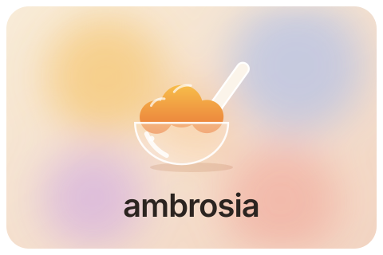

<div align="center">



# ambrosia

**A Linux desktop that looks and moves as one thing.**<br>
*Glass, springs, and one design language across every toolkit, on Arch.*

</div>

---

Linux desktops usually look inconsistent because no one owns the whole stack.
Each toolkit, app and theme follows its own rules. ambrosia starts from the
other end. It has one design authority ([`design/DESIGN.md`](design/DESIGN.md)),
one file of design values ([`design/tokens.ts`](design/tokens.ts)), and a
generator that turns those values into a theme for every toolkit. GTK, Qt/KDE,
the shell and font rendering all read the same numbers.

## Status

The design system, the theme generator, a browser preview of the desktop and a
design review site exist. The distro pipeline works end to end: Arch packages,
an Ambrosia session on KWin, our login screen, and an installer image that
boots a live desktop and installs it on UEFI and BIOS computers. A new install
starts behind the mark and a bar that fills, not the kernel's text (a
Plymouth theme; on a system installed before, `sudo pacman -S plymouth &&
sudo /usr/lib/ambrosia/boot-picture`). The shell
works on real hardware: the menu bar with the focused app's own menus, Search
(Super+Space: apps, settings, files and folders, sums), the Dock (drag to
reorder, magnification, a live Trash, Downloads as a stack), the control center, notification
banners and Notification Center, and a Mac-first keyboard (Command where a
Mac has it). Glass is a compositor effect of our own: each pane blurs and
saturates what is behind it as its material asks, and bends it at the rim;
Files' and Settings' sidebars are panes of it.
Its look still trails the design preview in places.

Three first-party apps are in. Files (a Finder look-alike) has icon, list,
column and gallery views, Quick Look, Get Info, tags, thumbnails, search by
name and contents, undoable file operations and the Trash; drives and
Applications in its sidebar and a copy progress window are still to come.
Settings (a System Settings look-alike) has every pane of its plan built on
the system's own services, from Wi-Fi and Bluetooth to Printers &
Scanners, Accessibility and Spotlight (`docs/settings/PLAN.md` says what each
leaves out). Calculator is a Mac's basic one: round keys, the sum shown as it
is typed, the keyboard throughout. Preview opens pictures and PDFs: pages
or pictures down a sidebar, zoom, turning, a PDF's table of contents, its
text searched, selected and copied. TextEdit writes plain text and rich
text with a format bar and a ruler, in RTF a Mac's TextEdit reads and
writes too.

## Quick start

```sh
make                       # test, build every theme and the review site, install on Linux
bun run review             # the design review site at http://localhost:4747
make remote-build          # the build gate on tenet, the Arch build box (Mac stays light)
make review-remote         # the review site served from tenet, tunnelled to localhost:4747
make shot-remote           # the mock desktop photographed in headless Firefox on tenet, into out/shots/
make gallery               # the Qt widget style's controls drawn into out/shots/ (needs Qt 6, CMake, Ninja)
make shell-shots           # the shell drawn into out/shots/ with no window on screen: the desktop, menus, panels (needs Qt Quick too)
open preview/index.html    # the mock desktop on its own (xdg-open on Linux)
```

On an Arch machine, the distro builds from the same checkout:

```sh
make package               # ambrosia-keyring, -theme, -shell, -input, -files, -desktop and the rest into out/pkg/
make quickshell            # our Quickshell (with the app menu and popup patches) for the installed Qt
sudo make iso              # the installer image, out/iso/ambrosia-*.iso
tools/vm.sh install        # install the image unattended in a headless VM
tools/vm.sh shot vm.png    # and photograph it
sudo tools/repo-test.sh    # install it in the VM, then pacman -Syu from the hosted repo
```

From the Mac, `make publish` builds the packages on tenet, signs them and
uploads them to Ambrosia's hosted pacman repo (`tools/publish-repo.sh`); the
signing key never leaves the Mac. Installed systems update from that repo:
the installer lists `[ambrosia]` first in their pacman.conf, and
`ambrosia-keyring` trusts its key.

`dd` the image onto a USB drive and boot it (UEFI). It starts a live Ambrosia
desktop and opens the installer, an assistant of our own that asks for a disk,
a name, a password and a time zone and does the rest; the installer needs the
internet (it offers the Wi-Fi networks in reach when there is none). Installing the packages
with `pacman -U` on an existing Arch system adds an "Ambrosia" session to the
login screen instead. `tools/remote.sh <host> <command>` runs a command in the
build box's own git checkout, synced from this one over SSH, and `tools/shot.sh`
photographs the shell on a headless KWin.

`make` needs [bun](https://bun.sh). On Linux it installs the themes for the
current user. Any config file ambrosia didn't write is kept beside it as
`<name>.before-ambrosia`. On other systems it only builds.

In the preview, **D** toggles dark mode, **A** cycles the accent, and
right-clicking a file opens its context menu. You can
also set the starting state in the URL: `?theme=dark&accent=honey&open=cc`
(the `open` value can be `cc` for the control center or `view-menu`).

## The design review site

`bun run review` serves a site for reviewing the design together. It has one
section per chapter of [`design/DESIGN.md`](design/DESIGN.md) and per entry in
[`design/DECISIONS.md`](design/DECISIONS.md). Each section shows the reasoning
and live examples built from the real tokens: the type scale, nested radii,
every accent with its measured contrast, the glass materials with each layer
switchable, the springs plotted and playable, and the desktop preview.

Each section takes a verdict (looks right, change it, discuss) and a notes
thread. With the review server running, these save to `design/review.json` in
the repo. Claude reads that file and replies in the same threads, and replies
appear in the open page within a few seconds. The site reads its text straight
from the two markdown files, so it can't drift from them.

`make build` also writes a static copy to `dist/site/`. Without the server it
keeps verdicts and notes in the browser, and **Copy review** turns them into
markdown you can paste into a chat.

## How it fits together

`design/tokens.ts` holds every value: type scale, 4px spacing grid, concentric
radii, OKLCH colors, glass materials, shadows and spring motion;
`design/cursors.ts` holds every shape the pointer takes, `design/icons.ts`
the app icons and what goes on folders and files, and `design/sounds.ts` the
recipes of the few sounds the desktop makes. `tools/gen`
resolves them once and writes each target from the same resolved model. It
converts colors to gamut-mapped sRGB, derives each accent's text and fill
colors to meet contrast targets, and solves the springs. Because of that,
an accent or a label color is identical in GTK, KDE and the shell.

| Output | For |
|---|---|
| `dist/gtk-4.0/gtk.css` | GTK 4 and libadwaita apps: colors as CSS variables, the controls and the traffic lights, light and dark |
| `dist/gtk-3.0/gtk-{light,dark}.css` | GTK 3 apps on Adwaita: colors, surfaces, the controls and the traffic lights, one file per mode |
| `dist/kde/Ambrosia{Light,Dark}.colors` | Qt and KDE apps |
| `dist/qml/Ambrosia/Theme.qml` | the shell (`import Ambrosia`, then `Theme.color…`) |
| `dist/fontconfig/50-ambrosia.conf` | Inter and JetBrains Mono as system fonts, grayscale AA, slight hinting |
| `dist/environment.d/50-ambrosia-fonts.conf` | FreeType stem darkening, for fuller text; no synthetic bold in Qt |
| `dist/kdecoration/tokens.h` | the KWin window frame (`decoration/`): traffic lights, title, corners, shadow |
| `dist/qstyle/tokens.h` | the Qt widget style (`style/`): the controls' sizes and the colors a palette has no role for |
| `dist/glass/tokens.h` | the glass effect (`glass/effect`): each material's blur as KWin's blur passes take it, its saturation, the rim's refraction |
| `dist/icons/Ambrosia/` | the icon theme, over Breeze: our app icons, folders and kinds of file under the names apps ask for, and the pointer (Xcursor files for apps, SVGs for KWin); every other name is a link. `dist/icons/sheet.html` and `dist/cursors/sheet.html` show them all |
| `dist/web/cursors.css`, `icons.css` | the same pointer and app icons for the preview and the review site |
| `dist/web/tokens.css` | the preview and any web surface |
| `dist/tokens.json` | everything resolved, for compositor effects and scripts |

`bun test` checks the spec's rules against the values: label and accent
contrast in both modes, concentric radii, and the spacing grid.

## Layout

```
CONTEXT.md     where things stand and what's next, for picking the work back up
design/        DESIGN.md (the rules), DECISIONS.md (the choices), tokens.ts (the values),
               cursors.ts (the pointer's shapes), icons.ts (app icons, folders, files),
               review.json (review verdicts and notes)
tools/gen/     the generator and its tests
tools/qmlshot/ draws a QML file into a picture with no window on screen; sheets/ lays pieces
               of the shell out, or opens things on the whole desktop (parts/Desk.qml), with
               the shell's own files loaded over stand-ins for Quickshell and Plasma (stubs/);
               make shell-shots
tools/         install.sh (per-user themes), build-iso.sh, vm.sh, shot.sh, remote.sh,
               live.sh (drive and photograph the session logged in on the build box),
               vm-try.sh (a throwaway copy of the test install, for the lock and login screens),
               publish-repo.sh (the hosted repo), repo-test.sh + repo-check.sh (its VM test)
shell/         the shell in QML for Quickshell: wallpaper, the desktop's icons and menu, menu bar (with apps' own
               status items) and menus, Search,
               Dock, control center, notifications, Force Quit, the emoji picker (its list, emoji.js, is written
               by tools/emoji.ts), password prompts (the shell is the polkit agent),
               a new account's welcome (Choose Your Look), the installer's assistant (Installer.qml),
               the volume and brightness keys' display,
               a screenshot's thumbnail in the corner,
               the plain tile under app icons that have none (AppTile.qml)
session/       the Ambrosia session: start script, systemd units, KWin and KDE defaults,
               how windows open and close and Mission Control (kwin-effects/, KWin effects of ours), the
               preview of where a dragged window will tile (kwin-outline/), the margin
               round a tiled window (kwin-scripts/),
               the lock screen (plasma-shell/: the login screen's own file, for KDE's locker),
               GTK's button layout (dconf), the `ambrosia` command and the shell's desktop files,
               what plays one of the sound theme's sounds by name (sound),
               the look-and-feel package with ⌘Tab's app switcher (a KWin switcher layout)
decoration/    the KWin window frame every app gets: a KDecoration3 plugin built on the tokens;
               qml/ is a small QML module for our QML inside KWin (the blur behind ⌘Tab, apps' names)
input/         the session's input method (ambrosia-input, plain C on libwayland): KWin starts it, and the
               shell types into the app in front through it (the emoji picker's choice)
glass/         glass (ambrosia-glass): protocol/ is how a surface names its panes of glass;
               effect/ is the KWin effect that draws behind them, forked from KWin's blur
               (GPL-2.0-or-later, unlike the rest; built for one KWin version);
               qml/ is org.ambrosia.glass, the GlassPane our QML puts where a pane is
style/         the Qt widget style the session names: other apps' buttons, boxes, sliders and menus, over Breeze;
               its gallery draws them all into a picture with no display (make gallery),
               or opens them as a window to use (ambrosia-style-gallery --show)
files/         Files, Ambrosia's Finder: Qt Quick UI, C++ core, art, benchmarks (bench/);
               it is also every app's Open and Save panel (the desktop portal's file chooser, src/portal.cpp)
               and tools/tenet.sh to build and photograph it on tenet
settings/      Settings, Ambrosia's System Settings: Qt Quick window, C++ core, art
calculator/    Calculator (ambrosia-calculator): the window in QML, its arithmetic in qml/calc.mjs,
               which calc.test.ts runs under bun
preview-app/   Preview (ambrosia-preview), for pictures and PDFs: the window in QML, PDFs through Qt's PDF
               library (src/document.cpp, src/pages.cpp), its zoom and layout arithmetic in qml/view.mjs,
               which view.test.ts runs under bun (preview/ is the older mock desktop, not this)
textedit/      TextEdit (ambrosia-textedit), plain and rich text: the window in QML, the document through
               src/editor.cpp, RTF read and written by qml/rtf.mjs, which rtf.test.ts runs under bun on
               Cocoa's own samples (samples/)
docs/GAPS.md   what still tells Ambrosia from a Mac, biggest first, and the rounds closing it
docs/finder/   the Files plan: research, stack, v1 scope, performance targets
docs/settings/ the Settings plan: the panes, their backends, the order of work
packaging/     PKGBUILDs: ambrosia-* and the Quickshell rebuild (with our DBusMenuSource patch),
               the repo's public key (keyring/), the os-release that names the system,
               what switches on the picture while starting up (plymouth/)
iso/           the archiso profile: live desktop, installer (ambrosia-install: the script under
               the shell's assistant, shell/Installer.qml)
preview/       the mock desktop, styled only from dist/web/tokens.css; glass.css is shared
site/          the design review site and its server
assets/        banner, icon and the "nectar" day/night wallpapers
```

## Roadmap

1. **Design system and theme generator.** Done.
2. **Packages and installer image.** First cut done: packages, the session, a
   live image, an unattended-testable installer for UEFI and BIOS computers,
   a login screen of our own, and a hosted, signed package repo installed
   systems update from. Everything after this ships through it.
3. **Shell** on KWin and Quickshell: menu bar, Dock, control center,
   notifications and Search work (first cut); next, matching the preview's
   look. The Mac-first keyboard is in: Super is Command in every app,
   through keyd (`docs/keyboard.md`). Built
   and judged on tenet, the Arch desktop, with a Magic Trackpad.
4. **Compositor**: a KWin effect for glass refraction and window animations on
   the spring tokens. Window frames are done: our own KWin decoration gives
   every app the traffic lights, and GTK's own titlebars match.
5. **Toolkits**: GTK apps' controls (begun: CSS over GTK 3's and GTK 4's
   stock themes draws buttons, fields, checkboxes, switches, sliders,
   menus, tabs and scroll bars from the same tokens, and GTK 3 follows
   dark), and a Qt widget style, which
   is begun (`style/`): push buttons, checkboxes, radio buttons, text
   fields, pop-ups, steppers, sliders, progress and scroll bars, menus,
   tabs, group boxes, the rows and headers of lists, trees and tables, and
   toolbars are drawn as macOS 26 draws them, over Breeze for the rest; it is
   the session's style, and its menus are glass where KWin blurs behind
   them. The
   "Ambrosia" icon theme is begun: the pointer (a Mac's black arrow and white
   hands, a wheel of our own for busy), icons for the apps a new install
   starts with, and folders and kinds of file as Files draws them, over
   Breeze for the rest.
6. **Apps**: the core first-party apps. Open and Save in other apps are
   Files' own panels already, through the desktop portal.
7. **Onboarding**: the installer is an assistant of our own and a new
   account is welcomed; asking Mac-first or Linux-first is still to do. The picture while starting up
   is there already.

Later: an ARM64 build for the Jetson Orin Nano.
