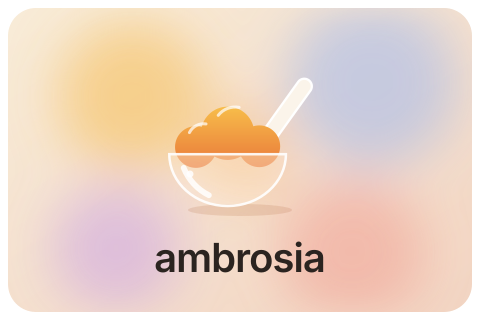

<div align="center">



# ambrosia

**A Linux desktop that looks and moves as one thing.**<br>
*Glass, springs, and one design language across every toolkit, on Arch.*

</div>

---

Linux desktops usually look inconsistent because no one owns the whole stack.
Each toolkit, app and theme follows its own rules. ambrosia starts from the
other end. It has one design authority ([`design/DESIGN.md`](design/DESIGN.md)),
one file of design values ([`design/tokens.ts`](design/tokens.ts)), and a
generator that turns those values into a theme for every toolkit. GTK, Qt/KDE,
the shell and font rendering all read the same numbers.

## Status

This is the foundation phase. The design system, the theme generator, a
browser preview of the desktop and a design review site exist. The Linux shell,
the compositor effects and the distro itself don't yet.

## Quick start

```sh
make                       # test, build every theme and the review site, install on Linux
bun run review             # the design review site at http://localhost:4747
open preview/index.html    # the mock desktop on its own (xdg-open on Linux)
```

`make` needs [bun](https://bun.sh). On Linux it installs the themes for the
current user. Any config file ambrosia didn't write is kept beside it as
`<name>.before-ambrosia`. On other systems it only builds.

In the preview, **D** toggles dark mode, **A** cycles the accent, and
right-clicking a file opens its context menu. You can
also set the starting state in the URL: `?theme=dark&accent=honey&open=cc`
(the `open` value can be `cc` for the control center or `view-menu`).

## The design review site

`bun run review` serves a site for reviewing the design together. It has one
section per chapter of [`design/DESIGN.md`](design/DESIGN.md) and per entry in
[`design/DECISIONS.md`](design/DECISIONS.md). Each section shows the reasoning
and live examples built from the real tokens: the type scale, nested radii,
every accent with its measured contrast, the glass materials with each layer
switchable, the springs plotted and playable, and the desktop preview.

Each section takes a verdict (looks right, change it, discuss) and a notes
thread. With the review server running, these save to `design/review.json` in
the repo. Claude reads that file and replies in the same threads, and replies
appear in the open page within a few seconds. The site reads its text straight
from the two markdown files, so it can't drift from them.

`make build` also writes a static copy to `dist/site/`. Without the server it
keeps verdicts and notes in the browser, and **Copy review** turns them into
markdown you can paste into a chat.

## How it fits together

`design/tokens.ts` holds every value: type scale, 4px spacing grid, concentric
radii, OKLCH colors, glass materials, shadows and spring motion. `tools/gen`
resolves them once and writes each target from the same resolved model. It
converts colors to gamut-mapped sRGB, derives each accent's text and fill
colors to meet contrast targets, and solves the springs. Because of that,
an accent or a label color is identical in GTK, KDE and the shell.

| Output | For |
|---|---|
| `dist/gtk-4.0/gtk.css` | libadwaita apps (CSS variables, light and dark) |
| `dist/gtk-3.0/gtk-{light,dark}.css` | GTK3 apps on adw-gtk3 / Adwaita |
| `dist/kde/Ambrosia{Light,Dark}.colors` | Qt and KDE apps |
| `dist/qml/Ambrosia/Theme.qml` | the shell (`import Ambrosia`, then `Theme.color…`) |
| `dist/fontconfig/50-ambrosia.conf` | Inter and JetBrains Mono as system fonts, grayscale AA, slight hinting |
| `dist/environment.d/50-ambrosia-fonts.conf` | FreeType stem darkening, for fuller text |
| `dist/web/tokens.css` | the preview and any web surface |
| `dist/tokens.json` | everything resolved, for compositor effects and scripts |

`bun test` checks the spec's rules against the values: label and accent
contrast in both modes, concentric radii, and the spacing grid.

## Layout

```
design/        DESIGN.md (the rules), DECISIONS.md (the choices), tokens.ts (the values),
               review.json (review verdicts and notes)
tools/gen/     the generator and its tests
tools/install.sh
preview/       the mock desktop, styled only from dist/web/tokens.css; glass.css is shared
site/          the design review site and its server
assets/        banner, icon and the "nectar" day/night wallpapers
```

## Roadmap

1. **Design system and theme generator.** Done.
2. **Shell** on Arch with KWin and Quickshell: menu bar, dock, control center,
   notifications and launcher, all on `Theme.qml`, plus the Mac-first keyboard
   layer (keyd). Built and judged on tenet, the Arch desktop, with a Magic
   Trackpad.
3. **Compositor**: a KWin effect for glass refraction, window animations on
   the spring tokens, and window decorations.
4. **Toolkits**: a Qt widget style and a full GTK theme beyond colors, an icon
   set and a cursor theme.
5. **Apps**: the core first-party apps, plus an XDG portal file chooser so file
   dialogs in other apps match too.
6. **Distro**: archiso image and Calamares installer, with onboarding that
   asks Mac-first or Linux-first.

Later: an ARM64 build for the Jetson Orin Nano.
